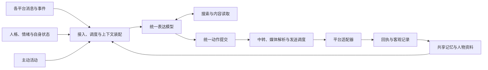

# real_bot

一个基于 AstrBot 的多平台仿真人项目，目标是让同一个角色在不同平台中保持连贯的记忆、人格、情绪和社交行为。

项目将“表达”和“执行”分开：统一的表达模型结合上下文决定说什么、联系谁、在哪个平台行动；外部程序完成消息路由、媒体处理、发送、回执确认与记忆记录。

## 设计思路

- **同一个角色，多种场景**：私聊、群聊、评论和发帖共享人格与全局状态，同时保留各自的局部上下文。
- **记忆连续**：结合当前会话、全局近期记录、中期摘要和长期检索，理解当前话题与跨平台经历。
- **表达与接口分离**：模型通过统一提交工具表达意图，平台差异由中转与适配程序处理。
- **主动与被动结合**：既能回应来信，也能在会话空闲时找话题，或探索感兴趣的内容后主动分享。
- **以实际结果记录行为**：区分生成、发送成功、失败和结果不确定，保留真实目的地、媒体与回执。

## 核心功能

### 记忆与关系

- 当前会话上下文、全局近期记忆、递归中期摘要和长期记忆检索。
- 用户及群聊资料整理，跨平台账号的疑似/确认身份关联。
- 全局情绪、按身份维护的好感度、作息与清醒状态。
- 私聊隐私状态、记忆可见范围控制和上下文去重。
- 全局人格与独立测试人格，支持分别编辑首部和尾部的人格内容。

### 消息与行为

- 私聊优先调度、群聊消息合批、动态参与概率和冷却控制。
- 统一动作提交、中转原文范围标记、确定性媒体提取及跨会话路由。
- 按平台支持文字、图片、随机表情池、视频、语音、@和引用。
- 分气泡发送、发送间隔与媒体插入顺序控制。
- 持久发送队列、去重、回执确认及故障隔离。

### 主动探索

- 显式自唤醒意愿与会话空闲触发主动。
- 兴趣探索和表达分为两轮，记录发现及其来源。
- 周期性浏览器探索，结合真实浏览记录与截图进行分享。
- B站动态和小黑盒发帖活动，支持不计入睡眠时间的周期调度。

### 工具与运维

- 联网搜索、网页读取及平台专用内容读取。
- 图片OCR、图片理解、语音转文字及语音合成。
- API Key集中管理、按模块记录模型与工具用量、费用估算。
- 机器人开关、群聊触发开关、私聊主动开关及人格上传工具。

## 平台接入

| 平台 | 已实现的主要能力 |
|---|---|
| QQ | 私聊、群聊、文字与媒体消息、@、群聊引用、视频卡片 |
| 微信 | 私聊、群聊、原生信息读取，桌面队列发送文字与媒体、@、虚拟麦克风语音 |
| Bilibili | 私信、个人动态、视频及评论读取、评论发布、回复与@通知接收 |
| 小黑盒 | 搜索、帖子与评论读取、图文发帖、评论及通知轮询 |
| 邮箱 | 邮件及附件接收 |

各平台能力由对应适配器实现。微信发送依赖已登录客户端和串行UI执行器；部分操作还受到平台审核或客户端能力限制。短信转发入口保留为可选模块。

## 架构

详细说明见[架构与边界](docs/ARCHITECTURE.md)和[模块地图](docs/MODULES.md)。

## 目录

| 目录 | 内容 |
|---|---|
| [modules/unified-mouth](modules/unified-mouth/) | AstrBot插件、统一表达、记忆、资料、状态、调度、主动系统及平台路由 |
| [modules/wechat-native](modules/wechat-native/) | 基于Webox的微信原生信息读取与接入 |
| [modules/wechat-ui](modules/wechat-ui/) | 微信会话选择、输入、@、媒体发送与持久队列 |
| [modules/wechat-voice-extraction](modules/wechat-voice-extraction/) | 微信语音提取 |
| [modules/wechat-asr](modules/wechat-asr/) | 独立语音转文字服务 |
| [modules/virtual-mic](modules/virtual-mic/) | 虚拟麦克风与微信录音发送 |
| [modules/genie-tts](modules/genie-tts/) | 语音合成、模型装载与量化工具 |
| [modules/heybox-bridge](modules/heybox-bridge/) | 小黑盒REST与CLI桥接 |
| [tools/operator](tools/operator/) | 开关、人格、密钥、隐私及用量管理 |
| [config/examples](config/examples/) | 配置模板 |
| [deploy](deploy/) | 服务与检查配置 |
| [docs](docs/) | 架构、依赖、部署和使用说明 |
| [archive](archive/) | 历史原型与兼容代码 |

## 开始使用

1. 阅读[外部依赖](docs/DEPENDENCIES.md)，准备AstrBot、所需平台客户端及可选模型。
2. 按[部署说明](docs/DEPLOYMENT.md)安装模块并配置运行目录。
3. 从 `config/examples/` 创建自己的配置，填写账号与凭据，逐项验证平台接入。
4. 按[运维工具说明](docs/OPERATIONS.md)管理服务、人格、主动策略和用量。

API密钥模板为空。凭据、登录状态、聊天与记忆数据、模型权重及个人媒体资源不随源码分发。提交前可运行 `python tools/check_public_tree.py` 检查源码与配置。

## 组件来源

第三方组件保留各自的许可证与来源，详见 [THIRD_PARTY_NOTICES.md](THIRD_PARTY_NOTICES.md)。
