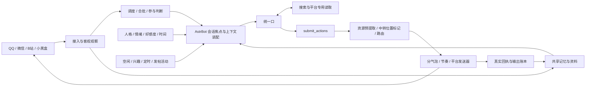

# 架构与边界

口决定表达，接入、检索、状态和投递由程序处理。中转 API 只标记原文位置和目的地，不重写正文。程序保存原文哈希、媒体位置、逻辑会话和发送回执；失败或结果不确定时不盲目重复发出。

## 记忆

- 当前会话历史提供当前焦点，默认最多20条。
- 全局近期库保留最近50条，注入时每个会话最多10条，并与当前历史查重；查询先过滤隐私，再按数量补足。
- 被近期库淘汰的客观记录进入长期库。累计300条淘汰记录触发递归中期摘要，目标约500字；持久草稿与精确长度反馈避免失败后重复发送整批原文。
- 长期检索分检索词生成、程序召回、候选筛选；身份疑似/确认信息作为检索资料，不由口自行推断绑定。
- 出站记忆按实际逻辑平台、会话、正文和媒体记录；隐私私聊的记录只在允许的记忆范围内可见。隐私不等于禁用跨会话发送。

## 主动与状态

空闲触发主动采用非睡眠时间计时和指数退避。兴趣主动分探索与表达，特殊轮调用隔离 DSH 浏览上下文并记录截图来源。主动调度与被动消息仍共用发送门禁及回执规则。

人格稳定、全局情绪共享、好感度按身份维护、作息按时间计算。主人QQ私聊测试人格覆盖仅发生在表达上下文；全局情绪和其他会话保持全局人格。代码中的示例账号需在部署时替换成自己的配置。

## 微信

读取与发送分开。读取走原生观察；发送走唯一队列和 UI 锁。会话选择使用截图/OCR候选、停止滚动、标题复核与列表归位；切换失败会暂停该目标，避免连续错误操作。引用保持停用；@失败有界重试。上游生成取消不得中断正在归位的导航动作。
